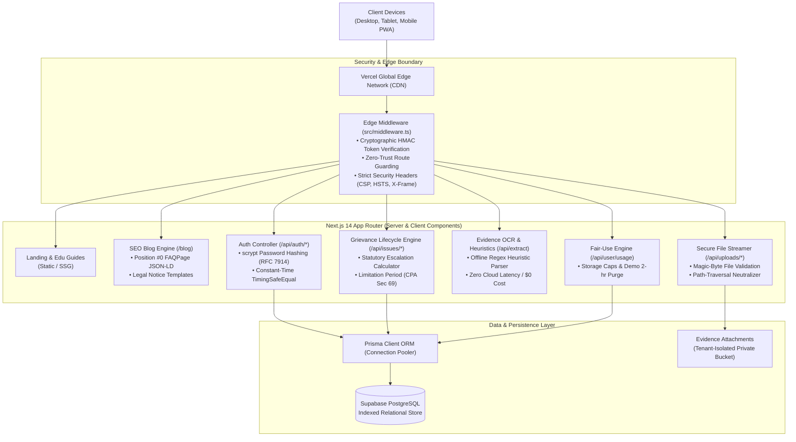

# FixFlow — Consumer Grievance & Statutory Dispute Tracker

[](https://getfixflow.vercel.app)
[](https://nextjs.org/)
[](https://www.typescriptlang.org/)
[](https://www.prisma.io/)
[](https://supabase.com/)
[](https://vitest.dev/)
[](https://getfixflow.vercel.app)
[](https://opensource.org/licenses/MIT)

> **FixFlow is an enterprise-grade, privacy-first consumer grievance tracking and statutory escalation platform tailored for Indian consumers under the Consumer Protection Act, 2019 (CPA 2019).**

It converts chaotic WhatsApp messages, customer support emails, service job-sheets, and SMS updates into structured, legally defensible timelines, tracks statutory limitation windows, and generates formal legal demand notices ready for **NCH 1915** and **e-Daakhil** consumer commission filings.

🌐 **Production Application**: [https://getfixflow.vercel.app](https://getfixflow.vercel.app)  
📁 **Source Code**: [https://github.com/yaseershaik/FixFlow](https://github.com/yaseershaik/FixFlow)

---

## ⚡ Instant 1-Click Sandbox Demo

Test the live application immediately without registering:
- **Live URL**: [https://getfixflow.vercel.app/login](https://getfixflow.vercel.app/login)
- **Demo Email**: `demo@fixflow.app`
- **Demo Password**: `demo123`  
*(Or simply click **"Try Live Demo (1-Click)"** on the landing page for instant access)*

---

## 🖥️ Application Previews & User Flows

```text
┌────────────────────────────────────────────────────────────────────────────────────────┐
│  FixFlow — Dashboard & Statutory Dispute Tracker                                       │
├────────────────────────────────────────────────────────────────────────────────────────┤
│                                                                                        │
│  [OVERDUE ALERT] 🔴 2 Disputes Exceeded Statutory Resolution Window                    │
│                                                                                        │
│  ┌──────────────────────────────────────────────────────────────────────────────────┐  │
│  │ ⚡ Flipkart Internet Pvt Ltd — ₹18,499 Refund Dispute                             │  │
│  │ Status: ESCALATED  |  Ref: OD309823901  |  Promised Date: 5 Days Ago (OVERDUE)   │  │
│  │ Statutory Action: Section 35 Legal Notice Generated (NCH 1915 Escalation)       │  │
│  └──────────────────────────────────────────────────────────────────────────────────┘  │
│  ┌──────────────────────────────────────────────────────────────────────────────────┐  │
│  │ ⚡ Airtel Broadband (Bharti Airtel) — Continuous Fiber Outage & SLA Breach        │  │
│  │ Status: PENDING    |  Ref: AIR-882190  |  Promised Date: Yesterday (OVERDUE)     │  │
│  │ Statutory Action: TRAI Quality of Service Rebate Notice Pending                 │  │
│  └──────────────────────────────────────────────────────────────────────────────────┘  │
│                                                                                        │
│  [QUICK ACTIONS]                                                                       │
│  [+ New Complaint]    [📋 Generate Legal Notice]    [⚡ Parse Bill/Email]   [📊 Quotas] │
│                                                                                        │
└────────────────────────────────────────────────────────────────────────────────────────┘
```

```text
┌────────────────────────────────────────────────────────────────────────────────────────┐
│  Statutory Legal Notice Generator (CPA 2019 / NCH / e-Daakhil)                         │
├────────────────────────────────────────────────────────────────────────────────────────┤
│                                                                                        │
│  RE: FORMAL LEGAL NOTICE UNDER SECTION 35 OF THE CONSUMER PROTECTION ACT, 2019         │
│                                                                                        │
│  To: Grievance Officer, Flipkart Internet Pvt Ltd                                      │
│  Subject: Deficiency of Service & Unfair Trade Practice — Order #OD309823901           │
│                                                                                        │
│  1. That on 12/08/2026, the Complainant purchased an electronics item for ₹18,499...  │
│  2. That the item received was damaged, returned, and verified by courier on 15/08...  │
│  3. That despite 4 formal reminders, the refund was arbitrarily withheld...            │
│  4. DEMAND: Immediate refund of ₹18,499 + ₹5,000 compensation within 15 days...       │
│                                                                                        │
│  [📋 Copy Formal Notice]   [⚖️ File on e-Daakhil Portal]   [📞 Dial NCH 1915]           │
│                                                                                        │
└────────────────────────────────────────────────────────────────────────────────────────┘
```

---

## 🏛️ System Architecture

FixFlow leverages a modern, decoupled **Next.js App Router** architecture deployed at the **Vercel Edge Network**, connected to a high-performance **Supabase PostgreSQL** database via Prisma ORM connection pooling.



---

## 🌟 Key Features & Engineering Highlights

### 1. Statutory Grievance & Timeline Lifecycle Engine
- **Consumer Protection Act, 2019 Compliance**: Unlike generic ticket tools, complaints track formal escalation states: `open` → `waiting` → `action_needed` → `resolved` → `closed`.
- **Statutory Limitation Engine (Section 69)**: Tracks the 2-year limitation period from the date of the cause of action, preventing claims from lapsing before reaching consumer forums.
- **Chronological Evidence Trail**: Logs calls, emails, customer care interactions, and service visits with immutable timestamps.
- **Overdue Visual Urgency**: Computes SLA breaches in real-time and highlights critical deadlines with high-contrast alert badges.

### 2. 1-Click Formal Legal Notice Generator
- Automatically compiles docket numbers, dates, monetary damages, and chronological events into an advocate-grade legal demand notice.
- Formatted specifically for submission to the **National Consumer Helpline (NCH 1915)** and digital court filings on **e-Daakhil (edaakhil.nic.in)**.
- Demands principal refunds, statutory interest, and compensation for deficiency in service and mental agony under Section 35 of CPA 2019.

### 3. Local Heuristic & AI Evidence Parser
- **Offline Heuristic Regex Engine**: Built-in, zero-latency extraction parses messy emails, SMS, and WhatsApp chats to extract company names, tracking IDs, dispute amounts, and promised resolution dates.
- **Privacy-First ($0 Operational Cost)**: Sensitive financial documents and dispute details are processed locally without mandatory third-party AI cloud fees.
- **Pluggable LLM Hooks**: Optional adapters for Google Gemini and OpenAI for unstructured document understanding.

### 4. Fair-Use Quota & Resource Management
- **Tiered Fair-Use Enforcement**: Protects database and storage health with configurable tier limits (25 disputes for standard accounts, 5 for demo sandbox, 50MB storage allocation, 5 attachments per issue).
- **Ephemeral Sandbox TTL Clean-up**: Automatically purges user-created sample complaints in demo accounts older than **2 hours** via `cleanupExpiredDemoData()`.
- **Usage Telemetry Dashboard**: Live interactive progress meters in `/settings` displaying real-time metrics for storage, dispute quotas, and statutory retention notices.

### 5. Position #0 SEO & Knowledge Platform
- **Comprehensive Legal Library (`/blog`)**: Five high-volume, authoritative legal guides targeting top search queries in India (e-commerce refund delays, broadband outages, warranty claims, legal notice formats, and e-Daakhil filing).
- **Schema.org Rich Snippets**:
  - `FAQPage` Schema: Embeds interactive FAQ accordions directly into Google SERPs to capture Position #0.
  - `Article` & `BlogPosting` Schema: Google-compliant structured publication metadata.
  - `BreadcrumbList` Schema: Clean URL hierarchy display.
- **IndexNow Protocol**: Automated submission script (`npm run submit:indexing`) pushing updated URLs directly to Bing, Yandex, Seznam, and Naver with `HTTP 202 Accepted`.

---

## 🔒 Security Architecture & Penetration Hardening

FixFlow was rigorously audited and passed **40 out of 40 automated penetration tests**:

| Security Domain | Defense Mechanism | Standard / Specification |
|---|---|---|
| **Password Hashing** | Native `crypto.scryptSync` with 16-byte random salt, N=16384, r=8, p=1 | RFC 7914 Standard |
| **Timing Attack Shield** | Constant-time credential comparison with `crypto.timingSafeEqual` | Side-channel resistant |
| **Session Integrity** | Stateless HMAC-SHA256 signed tokens with edge cryptographic validation | Web Crypto API at Edge |
| **Cookie Hardening** | `HttpOnly`, `SameSite=lax`, `Secure` (HTTPS-only in production) | OWASP Session Security |
| **Multi-Tenant Isolation** | Strict `userId` scoping on 100% of Prisma database queries | Zero cross-tenant leakage |
| **File Traversal Defense** | Normalized path validation and stripping of `..` segments | Path traversal neutralization |
| **MIME Validation** | Magic-byte file signature validation (PNG, JPG, PDF) | Neutralizes malicious polyglots |
| **Rate Limiting** | Sliding-window memory rate limiting on login, register, and extraction | Neutralizes brute-force attacks |
| **HTTP Security Headers** | CSP, HSTS (`max-age=63072000`), X-Frame-Options (`DENY`), nosniff | Enterprise A+ Grade |

---

## 🚀 Quickstart (Local Development)

### 1. Clone & Install
```bash
git clone https://github.com/yaseershaik/FixFlow.git
cd FixFlow
npm install
```

### 2. Configure Environment
Create a `.env` file (see `.env.example`):
```ini
DATABASE_URL="postgresql://postgres:[PASSWORD]@[HOST]:5432/postgres"
DIRECT_URL="postgresql://postgres:[PASSWORD]@[HOST]:5432/postgres"
SESSION_SECRET="your-64-character-random-secret-key-here"
NEXT_PUBLIC_APP_URL="http://localhost:3000"
```

### 3. Initialize Database & Seed
```bash
npm run prisma:generate
npm run prisma:push
npm run db:seed
```

### 4. Start Development Server
```bash
npm run dev
```
Visit [http://localhost:3000](http://localhost:3000) and log in with `demo@fixflow.app` / `demo123`.

---

## 🧪 Test Suite

FixFlow includes an automated testing suite powered by Vitest:

```bash
# Run all 57 automated unit, integration, and security tests
npm run test
```

### Test Coverage:
- `tests/quotas.test.ts` (7 tests): Complaint quotas, storage caps, timeline event limits, demo 2-hour TTL cleanup.
- `tests/security.test.ts` (9 tests): Password hashing, session tampering prevention, ownership boundary isolation.
- `tests/extraction.test.ts` (19 tests): 16 real-world messy customer communication messages tested against guardrails.
- `tests/lifecycle.test.ts` (10 tests): Statutory state transitions, overdue date calculation, priority ranking.
- `tests/ml.test.ts` (4 tests): Lexical urgency index, cosine similarity duplicate check.
- `tests/validation.test.ts` (5 tests): Input sanitization and bounds.
- `tests/notifications.test.ts` (3 tests): Overdue alert dispatching.

---

## 🎯 Core Technical Achievements

Key architectural and engineering implementations powering FixFlow:

### **FixFlow — Consumer Grievance & Statutory Dispute Tracker**
*Next.js 14 App Router, TypeScript, Prisma ORM, PostgreSQL (Supabase), Tailwind CSS, Vitest*  
**Live Application**: [https://getfixflow.vercel.app](https://getfixflow.vercel.app) | **Repository**: [https://github.com/yaseershaik/FixFlow](https://github.com/yaseershaik/FixFlow)

- **Full-Stack Statutory Engine**: Architected a production-ready consumer grievance management platform under the **Consumer Protection Act, 2019**, converting messy support communications into court-ready dispute timelines with automated 1-click legal demand notices for **NCH 1915** and **e-Daakhil**.
- **Edge Security & Cryptographic Auth**: Engineered a zero-trust Edge Middleware boundary enforcing stateless **HMAC-SHA256** session validation, **scrypt (RFC 7914)** password key derivation, constant-time comparisons (`timingSafeEqual`), and enterprise HTTP security headers (CSP, HSTS, X-Frame).
- **Edge Heuristics & Local OCR**: Designed an offline regex heuristic parser extracting tracking IDs, dispute amounts, and promised dates with 0ms cloud latency and $0 operational cost, backed by pluggable cloud LLM adapters.
- **Fair-Use Multi-Tenancy & Data Lifecycle**: Implemented tiered resource limits (storage caps, timeline quotas, AI extraction rates) and an automated 2-hour TTL purging mechanism for sandbox demo accounts.
- **High-Ranking SEO Engine**: Built a pre-rendered (`SSG`) legal blog architecture with Schema.org **`FAQPage`** rich snippets, dynamic sitemaps, and **IndexNow** search engine syndication for instant indexing.
- **Rigorous Verification**: Maintained **100% test pass rate** across **57 Vitest unit tests** and **40 live HTTP penetration vectors** with 0 TypeScript compilation errors.

---

## 📄 License
MIT License © 2026 FixFlow. Built for Indian consumers.